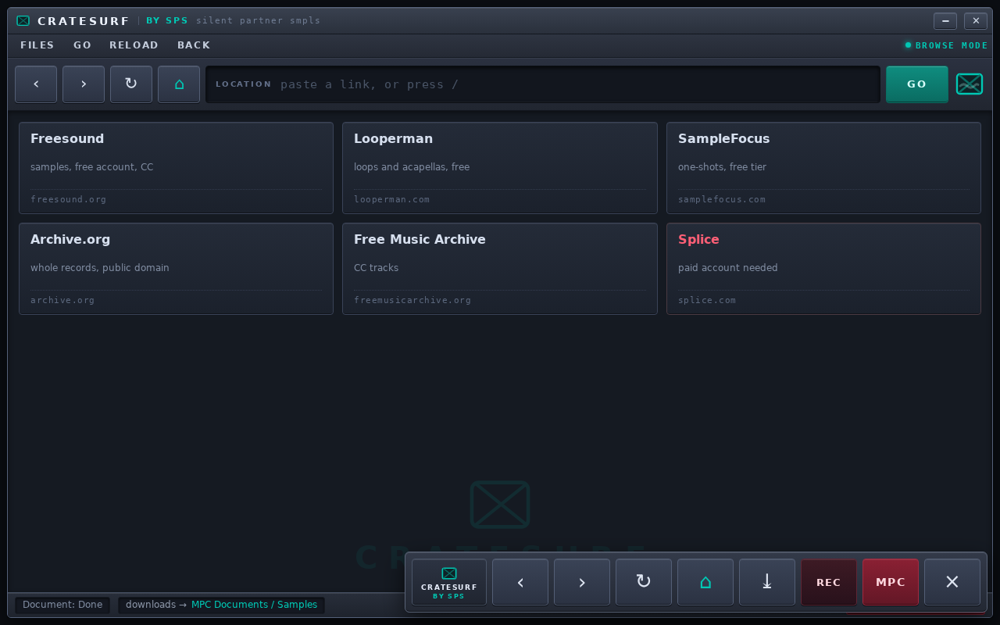
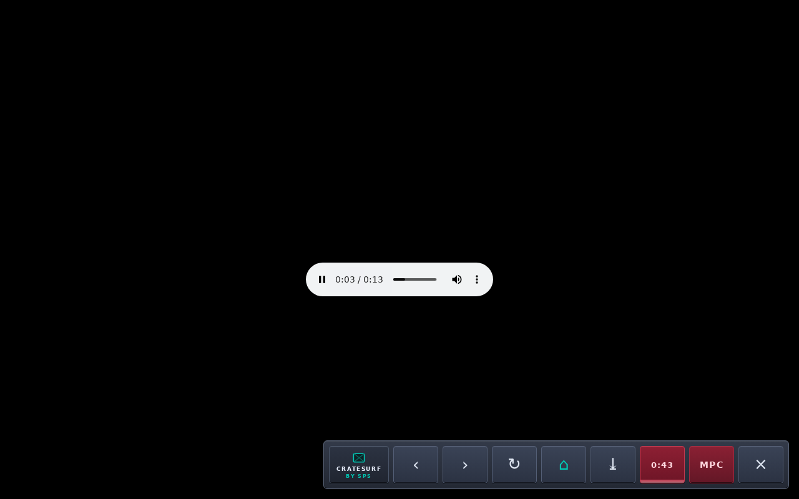

# CrateSurf by SPS

**A real web browser on your MPC.** Chromium on the MPC One+'s own touchscreen, with sound,
downloads that land straight in `MPC Documents/Samples`, and a navigation bar on every page
because kiosk mode has none. Dig for samples on the machine you are going to chop them on,
instead of shuttling files across from a computer.

[](#read-this-first)
[](#read-this-first)
[](#why-turning-it-on-means-turning-the-mpc-off)
[](LICENSE)
[](#contributing)

**Version 0.1.0-alpha** · MIT licensed · built for the MPC One+ (Gen 1), tested on exactly one unit



> **Your MPC ships with no browser.** Samples live on the internet, the MPC is where you chop
them, and the wire between those two facts was a USB stick and a laptop. That is the whole
reason this exists.

---

## READ THIS FIRST

This is **alpha software that modifies your MPC**. It writes ~800 MB of Debian userland to
`/data`, installs a systemd unit, and (only if you ask it to, with `--boot`) adds a file to the
MPC's read-only firmware partition. It stops and starts the MPC application to borrow the screen.

**Nobody is responsible for what happens to your device except you.** Not the author, not Akai,
not inMusic, not anybody who helped write it. That includes a dead panel, a boot loop, a wiped
project, a reformatted card, a voided warranty, or a bricked MPC. Read [DISCLAIMER.md](DISCLAIMER.md)
before you install anything; it is short and it is not a joke.

Three real risks, in plain words:

1. **Browse mode stops the MPC app, and the MPC app does not save your project when it exits.**
   CrateSurf turns the firmware's own autosave on before it stops the app, which is what makes it
   survivable, but up to 5 minutes of work can still be missing from the autosaved copy, and a
   project you have never saved is not protected at all. **Save your project before switching into
   browse mode.** This is the risk that will actually bite you.
2. **`install-service.sh --boot` writes to the firmware rootfs.** It remounts `/` read-write for a
   few seconds, copies one unit file, and remounts read-only. It is additive and verified, and
   [INSTALL.md](INSTALL.md#uninstalling) has the reverse of every step, but it is still your
   firmware partition.
3. **The port 8798 toggle has no authentication.** It is meant for a home LAN. Do not port-forward
   it, do not put it on a public network, do not expose it through a tunnel.

If that is all fine by you: welcome. It is a genuinely good way to browse for samples.

---

## What it actually is

The MPC's OS is a Yocto image with no package manager, no X, no Wayland, no GTK, no SDL, and no
Node. It does, however, ship **glibc 2.39**, which is the whole opening: Debian bookworm armhf
binaries only need 2.36, so they run here unmodified.

So CrateSurf is an **armhf chroot** full of real Debian packages (Chromium 150 when this was built, weston 10,
libinput, PulseAudio, fonts, the cursor theme), built on your PC from `.deb` files and copied to
`/data/browser/sysroot` on the MPC. A chroot rather than `LD_LIBRARY_PATH` because weston finds its
modules, and Chromium its resources, by absolute compiled-in paths.

On the device, one always-on Node server (port 8798) does the switching, and a small Chromium
extension draws the bar. Nothing runs on your computer at runtime. **Nothing in this project talks
to the internet except the browser you are using**, and the build script, which fetches the
`.deb` files from `deb.debian.org`.

## Why turning it on means turning the MPC off

`/usr/bin/MPC` holds DRM master the whole time it runs, and DRM master is exclusive, so a
compositor cannot draw while the MPC app is up. Browse mode is therefore a **mode switch, not a
window**: the MPC app stops, the browser owns the panel, and leaving browse mode starts the MPC app
again. There is no side-by-side. Nothing about the app is modified, but it does come back on its
template picker rather than the project you had open, because it does not reload the last project
on launch.

## Tested on

One unit. This is the honest extent of the testing:

| | |
| --- | --- |
| Device | Akai Professional MPC One+ (the Gen 1 One+, board `inmusic,az05`) |
| SoC | Rockchip RK3288, armv7l, 2 GB RAM, 2 cores |
| MPC OS | **3.4.2.13** (build `33b99bdb8ac`) |
| Kernel | 6.6.74-az01-2025-01-23-rt47, PREEMPT_RT |
| Base OS | Yocto 5.0.5 (scarthgap), glibc 2.39, systemd |
| Panel | `DSI-1`, 800x1280 portrait, rotated by weston to 1280x800 landscape |
| Audio | card 1 `ACVA` (`hw:1,0`), behind PulseAudio |
| Browser | Chromium 150.0.7871.100 in the chroot, weston 10.0.1, `--disable-gpu` |

The MPC firmware version matters. Everything here was found and verified on 3.4.2.13. A newer
firmware may move the rootfs partition, rename a service, or change the panel, and the install
scripts assume what 3.4.2.13 looks like.

## Might work on

**Untested. Assume it will not work until it does.** The thing that makes CrateSurf possible is a
specific combination, and a device has to have all of it:

- **armv7 (32-bit ARM) with a glibc of 2.36 or newer.** Check: `getconf GNU_LIBC_VERSION`.
- **A DRM panel that weston 10 can drive**, appearing as a connector (`card1-DSI-1` on the tested
  unit). Check: `ls /sys/class/drm`.
- **systemd, with an `/etc` overlay and a `/data` partition holding a couple of GB.** Check:
  `df -h /data`.
- **The MPC app present as `acvs.service`** and stoppable. Check:
  `systemctl status acvs`.
- **Root SSH access.** This project does not provide any way to get that; if you do not already
  have it, you are done before you start.
- **A Node.js runtime at `/data/mpc-agent/runtime/node/bin/node`** (v22 here). See
  [INSTALL.md](INSTALL.md#prerequisites) for what to do if you do not have one there.

Other RK3288-era MPCs (Live, Live II, X) are the plausible candidates, and they are plausible
rather than supported: different panel connectors, different partition layouts and different
firmware builds have all been seen across the range. Later MPCs on other SoCs are close to
certainly out.

There is a read-only probe for exactly this. Run it against your device before you touch anything:

```sh
./tools/probe-device.sh            # uses MPC_HOST, default root@mpc-one-mk2
```

It reports each of the axes above and prints `shape matches the tested unit` or names what does
not. It changes nothing on the device. If it says something does not match, that is not a bug
report we can act on; it is a device this has never been near.

## What it does not do

No tabs, no omnibox, no bookmarks, no extensions you can install yourself, and no PDF viewer you
would want. No hardware volume (card 1 exposes no ALSA mixer elements, so
PulseAudio's sink level is the only knob). The MPC's pads, knobs and data wheel cannot drive the
browser, because they are not Linux input devices on this unit. Fullscreen is refused on purpose,
so a video player that demands it will complain. Recording captures what the browser is playing,
not a microphone.

## Install

You need: a computer that can `ssh` and `scp` to the MPC, root on the MPC, and a Debian or Ubuntu
machine to build the chroot on (any recent one; the script sandboxes `apt` and installs nothing
system-wide).

```sh
git clone <the URL from this repo's green Code button> cratesurf
cd cratesurf

export MPC_HOST=root@192.168.1.50     # or root@mpc-one-mk2 if mDNS resolves

./tools/probe-device.sh               # does the device look like the tested one?
./build-sysroot.sh                    # ~240 MB of armhf .debs -> /data/browser/sysroot (~750 MB)
./deploy.sh                           # scripts, extension, weston.ini, kiosk pages
./deploy/install-service.sh --boot    # the 8798 toggle, and start it at boot
```

Then, on the MPC itself, hold **three fingers on the glass for 2.5 seconds**, or open
`http://<mpc-ip>:8798/` from your phone and tap **BROWSE ON THE MPC**.

Every step, every prerequisite, what each one writes, how to verify it and how to remove it again
is in **[INSTALL.md](INSTALL.md)**. Follow that rather than improvising; the order matters.

**And yes, this is the hard part.** That block assumes root SSH on a device with no terminal app, and
a Debian box with a package manager on another machine. It works and it is reversible, but if you
are looking at it going "hell nah", that is a completely fair reaction, and the graphical installer
in [ROADMAP.md](ROADMAP.md) is aimed straight at you.



## Using it

**Getting in**, three ways, because the panel belongs to the MPC app until something takes it:

- **three fingers held for 2.5 s**, anywhere on the glass, however close together. This is the one
  that matters, because it needs no other device.
- **Ctrl+Alt+B** on a USB keyboard plugged into the MPC.
- **`http://<mpc-ip>:8798/`** from your phone or PC, then **BROWSE ON THE MPC**.

**The bar.** Kiosk mode has no browser chrome, so the extension puts one in the bottom right of
every page: start page, back, forward, reload, downloads, **REC**, **MPC**, and a minimize box that
collapses the bar to a tab. It lives in a shadow root so a site's CSS cannot restyle or hide it,
and it re-appends itself if an ad covers it. **MPC** is the guaranteed way out: one tap ends the
session and hands the panel back, whatever the page is doing.

**Downloads** land in `MPC Documents/Samples`, which is the MPC's own sample folder. The bar's
downloads panel shows bytes and percent while a file is running (kiosk mode paints no download
bubble, so without it a download is invisible), and `FILES` in that panel lists the folder and
plays a sample back.

**REC** records whatever the browser is playing, straight into the sample folder as
`Web Grab NNN.wav`, at 44.1 kHz 16-bit stereo. Press it, play the thing, press it again. A take
stops itself after 10 minutes. This is the feature people end up using most.

**Getting out**: `EXIT BROWSE MODE` on the start page, the **MPC** button in the bar, or from a
shell:

```sh
ssh root@<mpc-ip> /data/browser/bin/browse-down.sh
```

## Known issues

Alpha means there is a list, and it is written down instead of discovered by you:
**[KNOWN-ISSUES.md](KNOWN-ISSUES.md)**. The five that matter most:

1. Saving first is on you, always (see risk 1 at the top).
2. The port 8798 toggle has no authentication.
3. No physical mouse has been in a port on the tested unit. A **keyboard** has, and works, hotplug
   and all. The pointer path is proven through the kernel's own input stack with synthetic HID; the
   last inch, a cable in a port, is what has not been tried.
4. The three-finger hold can fire from a hand resting on the panel. Duration is the only thing left
   separating a deliberate hold from a hand sitting still for 2.5 s, and that is an accepted trade.
   `HOLD_MS` in `device/bin/touch-launcher.js` is the knob.
5. Pages are usable, not snappy. There is no GPU: the Mali driver here is a vendor blob, so
   Chromium rasterises in software on an RK3288.

## What has actually been tested

On the unit, by a person, not simulated:

- **A USB keyboard**, plugged into the MPC, driving the browser and the bar, including hotplug in
  the middle of a session and `Ctrl+Alt+B` as a way in.
- **The three-finger hold**, with real fingers on the glass, repeatedly. It is also unit-tested and
  fires from a synthetic digitizer, but the fingers are the part that counts and they work.
- **Downloads**, from real sites, landing in `MPC Documents/Samples` and being there afterwards,
  including a 300 MB file with live progress in the panel. What lands is a complete, playable file,
  not a zero-byte stub.
- **REC**, producing a WAV whose loudest bin is exactly the frequency the page was playing.
- **Getting back out**, by the MPC button and by the start page, with the MPC app returning.
- **Sound**, listened to on the unit's own output. Audio was already proven at the signal level
  (`hw_ptr` advancing); it has since been heard, so this is not a number pretending to be a sound.
- **Boot persistence**, surviving two cold reboots.

What is left unproven is one thing: a physical **mouse**. That is in
[KNOWN-ISSUES.md](KNOWN-ISSUES.md), along with the things that are missing rather than untested.

## What is coming

[ROADMAP.md](ROADMAP.md) has the list. The short version, because these are the things people ask
for first: a real **download manager** (finished, failed, retry, cancel, sizes before you commit),
**unpacking archives on the device** so a `.zip` of sample packs does not need a computer in the
middle, and **choosing where a download goes** instead of everything landing in the library.

And the one that matters most for anyone finding this repo cold: **a graphical installer**. The
build-a-chroot-over-SSH route above is honest and it works, but it is a lot to ask before you have
seen a browser, and we know it. A GUI installer and a USB-stick route are the next pass.

## Contributing

Yes please. This thing was built in a week against one unit and there is a lot of obvious surface
left: tabs, a keyboard-aware URL entry, better scrolling, a proper download manager, gesture
tuning, and the whole of the untested list above.

Read [CONTRIBUTING.md](CONTRIBUTING.md) first. It maps the code, explains how to test on the
device without breaking a session, and lists the landmines that already cost someone an evening,
so you do not pay for them twice. Issues and PRs both welcome, and "it does not work on my MPC
Live II" is a useful report as long as you say which model and firmware.

There is no CI. Everything here needs the hardware; a green checkmark would prove nothing.

## Uninstall

Every step is reversible and [INSTALL.md](INSTALL.md#uninstalling) has the exact commands,
including removing the unit from the firmware rootfs and putting the MPC back exactly as it was.

## Tip jar (optional, genuinely optional)

CrateSurf is free, MIT, and stays that way. It was built for the love of the thing, not for a
business plan, and nothing in it is gated behind money.

That said: bills are real, model tokens are real, and this project runs on an unreasonable
amount of caffeine. So if it saved you an evening of shuttling WAVs across a room and you feel
like throwing something at it, that pays for the next one. Don't feel obliged. Nobody is owed
a dime and there is nothing behind the door.

- **Link:** *[ add the tipping link here ]*
- **Address / handle:** *[ add the address here ]*

## Credits and license

**CrateSurf by SPS** (*silent partner smpls*).

Built by two of us: the human who owned the question, the hardware and every design call, and
the AI that wrote the code and ran the tests. Both are named in
[CONTRIBUTORS.md](CONTRIBUTORS.md).

MIT licensed, see [LICENSE](LICENSE). Do what you like with it, keep the copyright line.

Not affiliated with, endorsed by or supported by Akai Professional or inMusic. "MPC" is their
trademark; it is used here only to say what this runs on.

Chromium, weston, PulseAudio and the rest of the chroot are Debian packages fetched at build time
and are **not** vendored in this repository. Their licences travel with them into the sysroot you
build; if you redistribute the sysroot, redistribute those licences with it.
